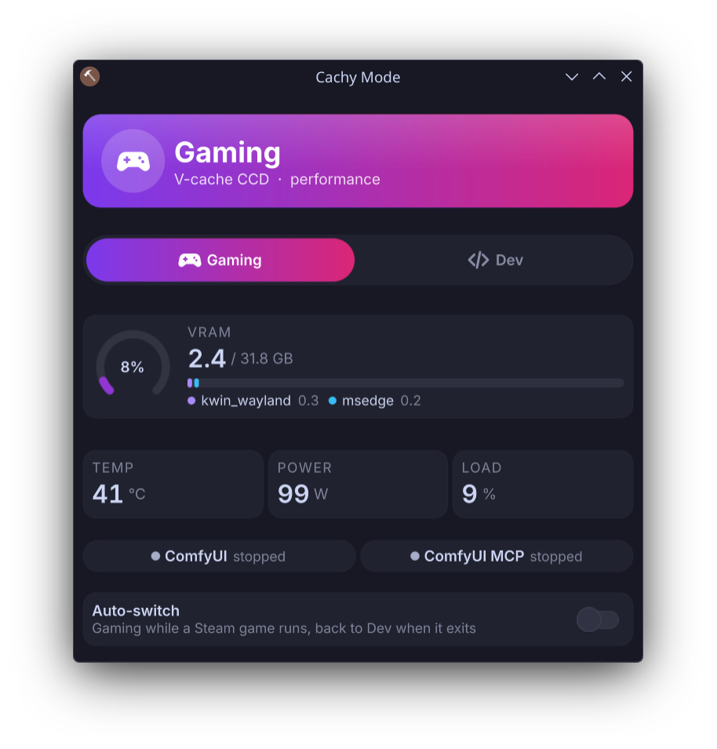

# cachy-mode

A one-click **Gaming ⇄ Dev** switch for AMD X3D + NVIDIA workstations running KDE Plasma 6.
It's built on CachyOS but works on any Arch-like distro. It lives in the system tray.

<p align="center"></p>

Dual-CCD X3D chips (7950X3D, 9950X3D, …) are fastest in games when the scheduler prefers the
**V-cache CCD**, and fastest at compiling and AI work when it prefers the **frequency CCD**. A GPU shared
with ComfyUI or local LLM servers also needs its VRAM freed before a heavy game. cachy-mode does both in one click:

| | Gaming | Dev |
|---|---|---|
| `amd_x3d_mode` | `cache` (V-cache CCD) | `frequency` |
| Power profile | performance | balanced |
| Your GPU services (systemd user units) | stopped | restored to what was running before |

- **Auto-switch** (optional): switches to Gaming while a Steam game runs and back when it exits.
  It only reverts switches it made itself.
- **Fails closed:** Gaming mode refuses while ComfyUI has queued jobs. The widget offers **Force** for that case.
- **Live stats:** VRAM ring and per-process breakdown, plus GPU temperature, power and load (via `nvidia-smi`).

## Requirements

- Linux ≥ 6.13 with the `amd_x3d_vcache` driver (dual-CCD X3D CPU). Without it, only the power profile and services switch.
- KDE Plasma 6, `power-profiles-daemon`, `jq`, `curl`, `libnotify`, `procps-ng`. `nvidia-smi` is optional (GPU stats).

## Install

```bash
git clone https://github.com/seanGSISG/cachy-mode ~/projects/cachy-mode
cd ~/projects/cachy-mode
./install.sh          # CLI → ~/.local/bin, user unit, tray widget (restarts plasmashell)
```

Writing the X3D mode needs root. Allow just that one write without a password:

```bash
sudo install -m 0440 examples/sudoers-cachy-mode /etc/sudoers.d/cachy-mode && sudo visudo -c
```

Choose which services to stop for gaming (optional; by default none are stopped):

```bash
mkdir -p ~/.config/cachy-mode && cp examples/config ~/.config/cachy-mode/config && $EDITOR ~/.config/cachy-mode/config
```

## CLI

```
cachy-mode gaming [--force]   # switch to Gaming
cachy-mode dev                # switch to Dev
cachy-mode status [--json]    # what the widget reads
cachy-mode auto on|off        # Steam auto-switch (cachy-mode-auto.service)
```

State lives in `~/.local/state/cachy-mode/`. Re-run `./install.sh` to upgrade.

## Uninstall

```bash
cachy-mode auto off
kpackagetool6 -t Plasma/Applet -r me.lsdmt.cachymode
rm ~/.local/bin/cachy-mode ~/.config/systemd/user/cachy-mode-auto.service
sudo rm -f /etc/sudoers.d/cachy-mode
```

## License

MIT
